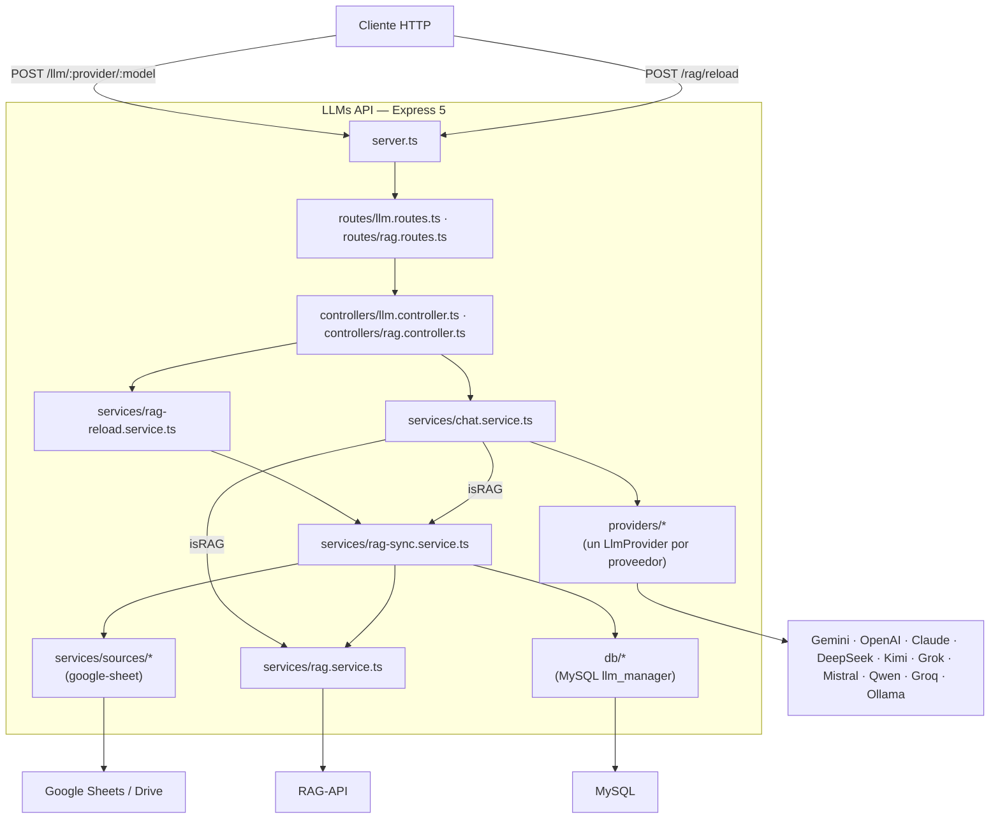
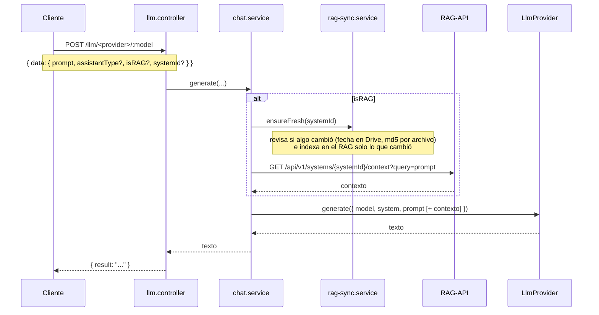

# LLMs API

API unificada que actúa como proxy hacia múltiples proveedores de modelos de lenguaje (LLMs), exponiendo una interfaz consistente independiente del proveedor. Opcionalmente enriquece cada pregunta con contexto de una RAG-API, que se mantiene al día con los archivos dinámicos de cada sistema (por ejemplo, las pestañas de una planilla de Google Sheets).

> Desarrollado con **Node 24**, **TypeScript ESM** y **Express 5**. Desplegado vía Docker en el puerto `8065`.

---

## Tabla de contenidos

- [Arquitectura](#arquitectura)
- [Flujo de petición](#flujo-de-petición)
- [Proveedores y modelos](#proveedores-y-modelos)
- [Archivos dinámicos y RAG](#archivos-dinámicos-y-rag)
- [Referencia de endpoints](#referencia-de-endpoints)
- [Variables de entorno](#variables-de-entorno)
- [Instalación y ejecución](#instalación-y-ejecución)

---

## Arquitectura

Los controladores son agnósticos: solo validan la petición, delegan en un servicio y responden. Todos los LLM implementan la misma interfaz (`LlmProvider`), así que agregar uno nuevo es agregar una entrada en `providers/index.ts`.



---

## Flujo de petición



---

## Proveedores y modelos

| Proveedor | Ruta | Modelos | SDK | API key |
|-----------|------|---------|-----|---------|
| **Gemini** | `/llm/gemini` | `gemini-2.0-flash` · `gemini-2.0-flash-lite` · `gemini-2.5-pro-preview-05-06` · `gemini-2.5-flash` · `gemini-2.5-pro` | `@google/generative-ai` | `GEMINI_API_KEY` |
| **OpenAI** (incluye Codex) | `/llm/openai` | `gpt-4o` · `gpt-4o-mini` · `o4-mini` · `gpt-5-codex` | `openai` (Responses API) | `OPENAI_API_KEY` |
| **Kimi** | `/llm/kimi` | `moonshot-v1-8k` · `moonshot-v1-32k` · `moonshot-v1-128k` | `openai` + baseURL | `KIMI_API_KEY` |
| **DeepSeek** | `/llm/deepseek` | `deepseek-chat` · `deepseek-reasoner` | `openai` + baseURL | `DEEPSEEK_API_KEY` |
| **Claude** | `/llm/claude` | `claude-opus-5-5` · `claude-sonnet-5-5` · `claude-haiku-5-5` | `@anthropic-ai/sdk` | `ANTHROPIC_API_KEY` |
| **Grok** | `/llm/grok` | `grok-4` · `grok-3-mini` | `openai` + baseURL | `XAI_API_KEY` |
| **Mistral** | `/llm/mistral` | `mistral-large-latest` · `mistral-medium-latest` · `mistral-small-latest` · `codestral-latest` | `openai` + baseURL | `MISTRAL_API_KEY` |
| **Qwen** | `/llm/qwen` | `qwen-max` · `qwen-plus` · `qwen-turbo` | `openai` + baseURL | `QWEN_API_KEY` |
| **Groq** | `/llm/groq` | `llama-3.3-70b-versatile` · `llama-3.1-8b-instant` | `openai` + baseURL | `GROQ_API_KEY` |
| **Ollama** (local) | `/llm/ollama` | `llama3.2` · `qwen2.5` · `mistral` | `openai` + baseURL | sin key (`OLLAMA_BASE_URL`) |

- La lista de modelos es informativa: el modelo indicado en la URL se envía tal cual al proveedor.
- Un proveedor sin API key responde `503` solo en su ruta; el resto de la API sigue funcionando.
- Claude Opus 5.5 y Sonnet 5.5 se llaman con el fallback del servidor activado (`fallbacks: "default"`): si los clasificadores de seguridad rechazan una solicitud, responde otro modelo en la misma llamada.

---

## Archivos dinámicos y RAG

Los **archivos dinámicos** son los que cada sistema necesita mantener actualizados en la RAG-API. Se registran en MySQL, en el esquema exclusivo `llm_manager` (DDL en `app/sql/001_rag_registry.sql`):

- **`rag_sources`**: las fuentes de cada sistema (`type`, `reference`, `system_id`, `remote_checksum`, `active`). La columna `remote_checksum` se agrega con `app/sql/002_rag_sources_checksum.sql`.
- **`rag_files`**: un registro por archivo enviado al RAG:
  - `id` incremental, `filename` (con extensión), `md5sum`, `size_bytes`, `origin`, `system_id`.
  - `created_at`, `last_indexed_at`, `update_count`, `metadata` (JSON).

**Preprocesamiento por tipo de fuente:**
- `google-sheet`: cada pestaña de la planilla se descarga como CSV, se convierte a Markdown de registros (sin tablas) y se envía como un archivo aparte, con el nombre `<planilla>_<pestaña>.md` (espacios reemplazados por `_`). La planilla completa nunca se sube.
  - Cada fila es un registro `- **Etiqueta:** valor` (solo las celdas con valor), y los registros se separan por una línea en blanco.
  - Las tablas que están lado a lado o separadas por filas vacías dentro de la pestaña se detectan (considerando las celdas combinadas) y se escriben una debajo de otra, cada una como sección `##` con su título o `Tabla N`.
  - Los bloques etiqueta/valor (ej. `Total Ingreso | $8,800,000`) se escriben como `- **Total Ingreso:** $8,800,000`.

**Cómo se decide qué indexar:**
1. **Revisión rápida (antes de procesar nada):** se calcula el md5 de la planilla completa con una sola llamada a la API de Sheets (nombres de pestañas, celdas combinadas y valores, ~0,3 s). Si es igual al `remote_checksum` guardado, no se descarga ni se procesa nada. Si cambió, se sigue con los pasos siguientes y, si todo queda en el RAG sin errores, se guarda el md5 nuevo. No se usa el md5 de la exportación xlsx porque Google le incluye la fecha y cambia en cada descarga.
2. **md5 por archivo:**
   - Archivo nuevo → se indexa en el RAG (`created`).
   - Mismo nombre y md5 distinto → el contenido cambió, se re-indexa (`updated`, `update_count + 1`).
   - Mismo md5 → no se llama al RAG (`unchanged`).
3. **Archivo que ya no existe en el origen** (por ejemplo, una pestaña borrada) → se elimina del RAG y del registro (`deleted`).

**Registrar una fuente:**

```sql
INSERT INTO llm_manager.rag_sources (type, reference, system_id, name)
VALUES ('google-sheet', '<spreadsheetId>', '<system_id>', '<nombre>');
```

La planilla de `SHEETS_SPREADSHEET_ID` se registra sola para `RAG_SYSTEM_ID` al iniciar la API.

---

## Referencia de endpoints

### `GET /`

Retorna el estado del servidor y los proveedores registrados.

```json
{ "status": "ok", "providers": ["gemini", "openai", "kimi", "deepseek", "claude", "grok", "mistral", "qwen", "groq", "ollama"] }
```

---

### `GET /llm/{provider}`

Lista los modelos del proveedor. Proveedor desconocido → `404`.

```json
{ "provider": "gemini", "models": ["gemini-2.0-flash", "gemini-2.0-flash-lite", "gemini-2.5-pro-preview-05-06", "gemini-2.5-flash", "gemini-2.5-pro"] }
```

---

### `POST /llm/{provider}/{model}`

Envía un prompt al modelo indicado y retorna la respuesta generada.

**Cuerpo de la petición**

```jsonc
{
  "type": "encripted",          // opcional — reservado para futura lógica de desencriptado
  "data": {
    "prompt": "string",         // requerido
    "assistantType": "string",  // opcional — "chat" (default) o la instrucción de sistema a usar
    "isRAG": true,              // opcional — usar o no el RAG (ver abajo)
    "systemId": "uuid"          // sistema del RAG; si no viene, se usa RAG_SYSTEM_ID
  }
}
```

**Campo `isRAG`**

| Valor | Comportamiento |
|-------|---------------|
| `true` | Revisa si cambió algún archivo dinámico del sistema, indexa solo lo que cambió, consulta el contexto en la RAG-API y lo antepone al prompt. Sin `systemId` (ni `RAG_SYSTEM_ID`) → `400`. |
| `false` | Va directo al LLM: no consulta el RAG ni descarga nada. |
| ausente | Igual que antes de existir el campo: usa el RAG si hay sistema (`systemId` o `RAG_SYSTEM_ID`). |

**Campo `assistantType`**

| Valor | Comportamiento |
|-------|---------------|
| `"chat"` (default) | Instrucción de sistema predeterminada del proveedor: Gemini *"…respondes de manera formal"*; el resto *"…respondes de forma divertida"*. |
| Cualquier otro texto | Se usa directamente como instrucción de sistema. |

**Respuestas**

| Código | Cuerpo |
|--------|--------|
| `200` | `{ "result": "Texto generado por el modelo..." }` |
| `400` | `{ "error": "El campo \"prompt\" es requerido." }` |
| `404` | `{ "error": "Proveedor desconocido: \"...\"." }` |
| `503` | `{ "error": "El proveedor \"...\" no está configurado: falta ..._API_KEY." }` |
| `500` | `{ "error": "Error al generar el contenido." }` |

**Ejemplo**

```bash
curl -X POST http://localhost:8065/llm/gemini/gemini-2.5-flash \
  -H "Content-Type: application/json" \
  -d '{ "data": { "prompt": "¿Cuánto ha pagado Agustina en cuotas?", "assistantType": "Eres un asistente contable.", "isRAG": true, "systemId": "<uuid>" } }'
```

---

### `POST /rag/reload[?systemId=<uuid>]`

Revisa todos los archivos dinámicos (o solo los del sistema indicado) y recarga en el RAG los que cambiaron. Primero compara el md5 de cada fuente: si no cambió, no descarga nada y responde sus archivos como `unchanged`. Si cambió, descarga la fuente y el md5 de cada archivo decide qué se re-indexa.

- La petición queda bloqueada hasta que termina la recarga.
- Mientras corre, y durante `RAG_RELOAD_COOLDOWN_SECONDS` (10 por defecto) después de terminar, responde `429` con el header `Retry-After`.

```json
{
  "systems": [
    { "systemId": "<uuid>", "files": [
      { "filename": "Tesorería_3°_A_y_B_Cuotas.md", "action": "updated" },
      { "filename": "Tesorería_3°_A_y_B_Items.md", "action": "unchanged" }
    ] }
  ],
  "durationMs": 39664
}
```

`action`: `created` · `updated` · `unchanged` · `deleted` · `error` (con campo `error`).

---

## Variables de entorno

Crea el archivo `../envs/llms.env` relativo a la raíz del repositorio (usado por Docker Compose):

```env
# Proveedores (incluir solo los que se vayan a usar)
GEMINI_API_KEY=...
OPENAI_API_KEY=...
DEEPSEEK_API_KEY=...
KIMI_API_KEY=...
ANTHROPIC_API_KEY=...
XAI_API_KEY=...
MISTRAL_API_KEY=...
QWEN_API_KEY=...
GROQ_API_KEY=...
OLLAMA_BASE_URL=http://localhost:11434/v1   # opcional

# RAG-API
RAG_API_URL=http://192.168.1.71:5000
RAG_SYSTEM_ID=...            # sistema por defecto si la petición no envía data.systemId
RAG_API_KEY=...              # API key del sistema por defecto
RAG_API_KEYS={"<system_id>":"<api_key>"}  # opcional — API keys de otros sistemas
RAG_TOP_K=10                 # opcional, por defecto 10 (máx. 50)
RAG_RELOAD_COOLDOWN_SECONDS=10   # opcional — espera tras POST /rag/reload

# Registro de archivos dinámicos (MySQL)
HOST_BD=...
PORT_BD=3306
USER_BD=...
PASS_BD=...
SCHEMA_BD=llm_manager

# Google Sheets: planilla que se registra sola como fuente de RAG_SYSTEM_ID
SHEETS_SPREADSHEET_ID=...
```

Coloca además el archivo de cuenta de servicio de Google en `../envs/credentials-excel.json`; Docker lo monta en el contenedor como `credentials.json`. La cuenta de servicio necesita acceso de lectura a la planilla.

---

## Instalación y ejecución

### Base de datos (una vez)

Ejecuta `app/sql/001_rag_registry.sql` en el MySQL. Crea el esquema `llm_manager` y sus tablas; es idempotente.

### Con Docker (recomendado)

```bash
docker compose up --build
```

La API quedará disponible en `http://localhost:8065`.

### Desarrollo local

```bash
cd app
npm install
npm run dev      # hot reload con nodemon + ts-node (vigila src/**/*.ts)
```

La API quedará disponible en `http://localhost:3000`.

### Otros comandos

```bash
npm start        # sin hot reload
npm run build    # type-check y compilación TypeScript
```
